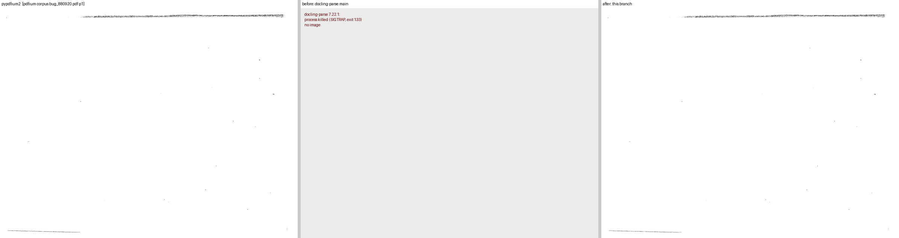
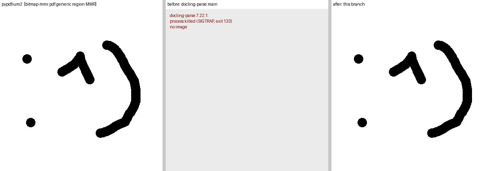
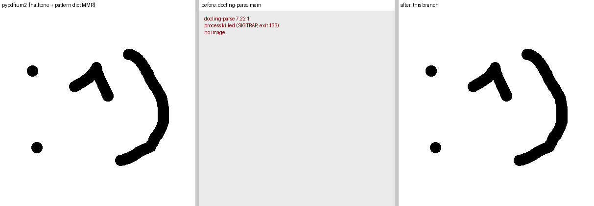
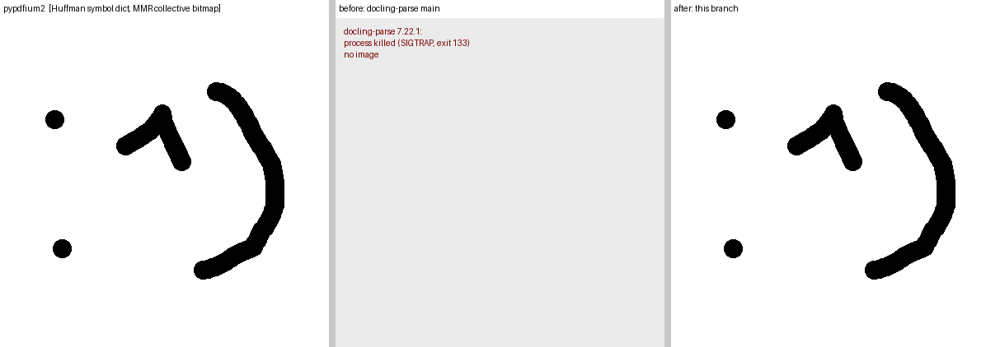

# Evidence for docling-parse PR: restore pdfium's Group 4 decoder for MMR-coded JBIG2 (issue #440)

Renders at scale 1 with the threaded parser; "before" is the docling-parse 7.22.1 wheel
(same code in this path as `main`), "after" is the PR branch. pypdfium2 5.13.0 is the reference.

## Three-panel comparisons (pypdfium2 | before | after)

| page | before | after vs pypdfium2 |
|---|---|---|
| `pdfium/bug_880920.pdf` p1, pdfium test corpus (a 3300x2550 scanned page: Huffman symbol dictionary with MMR collective bitmaps) | SIGTRAP, exit 133 | mean_abs_error 0.159, changed_pixels_ratio 0.0079 |
| `third_party/jbig2/bitmap-mmr.pdf` (generic region, MMR) | SIGTRAP, exit 133 | identical (0.000 / 0.0000) |
| `third_party/jbig2/bitmap-halftone-10bpp-mmr.pdf` (pattern dictionary + halftone region, MMR) | SIGTRAP, exit 133 | identical |
| `third_party/jbig2/bitmap-symbol-symhuff-texthuff.pdf` (Huffman symbol dictionary, MMR collective bitmap) | SIGTRAP, exit 133 | identical |

Sources: pdfium test corpus (https://pdfium.googlesource.com/pdfium_tests, revision 8621963).
`third_party/jbig2/*.pdf` are the SerenityOS JBIG2 tests converted to PDF, BSD-2-Clause.

## All 52 JBIG2 files of the pdfium corpus `third_party/jbig2` set plus `bug_880920.pdf`

Every SerenityOS test decodes to the same 399x400 bitmap, so each "after" render is also
compared with that bitmap (the `bitmap-mmr.pdf` render, which is pixel-identical to pypdfium2).

| group | files | before | after |
|---|---|---|---|
| MMR users (generic, halftone+pattern, Huffman symbol dictionaries) | 21 | all SIGTRAP | 21 survive; 15 identical to the reference bitmap, 6 render blank (see below) |
| non-MMR | 31 | render | unchanged: 28 identical to the reference, 3 blank before and after (`manyrefs`, `manysyms`, `symhuff-texthuff-manysyms`; pdfium renders the `manysyms` variants blank too) |

The 6 MMR files that now survive but render blank (`symhuffrefineone`, `symhuffrefine-textrefine`,
`symhuffrefine-textrefine-export`, `context-reuse-huffman-refagg`, `texthuffrefinecustom`,
`texthuffrefinecustomposdims`) decode their MMR collective bitmap, then fail in a second,
Huffman refinement/aggregate symbol dictionary (`ParseSegmentData` returns 1, `StartDecode`
returns `kError`). pypdfium2 renders them. That is a separate limitation of the vendored
decoder's Huffman refinement path and is not touched by this PR.

## Corpus scan

A segment-header scan of the docling-parse regression dataset (453 documents) finds JBIG2 in one
document only, `complex_jbig2_overlays.pdf`, and it is arithmetic-coded throughout, so no
regression page reproduces the problem. The same scan over the pdfium test corpus finds 22 files
with MMR coding (`pdfium/bug_880920.pdf` and 21 files under `third_party/jbig2/`), which are the
files used above.
